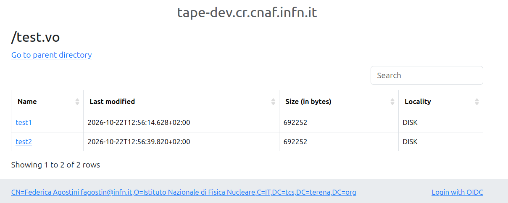

# Testing

This folder holds a docker compose file with a StoRM WebDAV instance used to populate the `dteam` and `test.vo` Storage Areas (SA) at https://tape-dev.cr.cnaf.infn.it:8444/dteam and a StoRM Tape instance used for testing at https://tape-dev.cr.cnaf.infn.it:8443/api/v1.

## Setup

Access to the SAs and to StoRM Tape is based on tokens JWT. Personal access based on X.509 certificate DN can be configured for testing (mail to federica.agostini@cnaf.infn.it), as it is for my account.

Register an `oidc-agent` client with at least `openid`, `offline_access`, `storage.stage:/` and `storage.poll:/` scopes, e.g.

```bash
oidc-gen dteam -w device
```

Alternatively, one can register a `client_credential` client with just the `openid`, `storage.stage:/` and `storage.poll:/` scopes.

### Populate SAs with StoRM WebDAV

In order to populate the `dteam` SA you just need a token issued by `https://dteam-auth.cern.ch/`; if we want to populate the `test.vo` SA the token must be issued by `https://iam-dev.cloud.cnaf.infn.it/` -- see [policy file](../storm-webdav/application-policies.yml) for StoRM WebDAV policy configuration. From now on examples are with `test.vo` but `dteams` works exactly in the same way.

Get a token (e.g. with oidc-agent)

```bash
BT=$(oidc-token -s openid test.vo)
```

Upload two test files as follows

```bash
curl https://tape-dev.cr.cnaf.infn.it:8444/test.vo/test1 --upload-file /etc/services -H "Authorization: Bearer $BT"
curl https://tape-dev.cr.cnaf.infn.it:8444/test.vo/test2 --upload-file /etc/services -H "Authorization: Bearer $BT"
```

**To successfully issue this and the next commands your local machine should have an operating system bundle containing also IGTF certificates; if not, add the `-k` option to skip SSL verification**


From the StoRM WebDAV URL (https://tape-dev.cr.cnaf.infn.it:8444/test.vo) you will see the two files living on _DISK_.
Authentication to the UI here happens with my personal certificate, but the bottom right link also allows to login with
INDIGO IAM.



## Stage bulk request with StoRM Tape

In the StoRM machine one cron job runs every 15 minutes to migrate the files on tape; in this case the file locality will be _DISK_AND_TAPE_. Moreover, another cron job runs every 5 hours to simulate the garbage collector on disk, such that the _stubbified_ files will appear with locality _TAPE_.

Prepare a staging file to recall the two files, such as

```bash
$ cat stage-testvo.json 
{
    "files": [
                {
                    "path": "/test.vo/test1"
                },
                {
                    "path": "/test.vo/test2"
                }
            ]
}
```

Cross-check that with the general token you cannot submit a stage request

```bash
$ curl https://tape-dev.cr.cnaf.infn.it:8443/api/v1/stage -H "Authorization: Bearer $BT" -d@stage-testvo.json
<html>
<head><title>403 Forbidden</title></head>
<body>
<center><h1>403 Forbidden</h1></center>
<hr><center>nginx/1.28.0</center>
</body>
</html>
```

Ask for a token with `storage.stage:/` (plus more path if needed) scope and submit a bulk request

```bash
$ BT=$(oidc-token -s storage.stage:/ test.vo)
$ curl https://tape-dev.cr.cnaf.infn.it:8443/api/v1/stage -H "Authorization: Bearer $BT" -d@stage-testvo.json -s  | jq
{
  "requestId": "332d712e-b3dd-4960-a889-6363c3d67dc0"
}
```

At most after 15 minutes, the file locality should be one of _DISK_ or _DISK_AND_TAPE_ (StoRM Tape allows to inspect the `archiveinfo` response also with the same body format as the stage submission)

```bash
$ curl https://tape-dev.cr.cnaf.infn.it:8443/api/v1/archiveinfo -H "Authorization: Bearer $BT" -d@stage-testvo.json -s  | jq
[
  {
    "path": "/test.vo/test1",
    "locality": "DISK_AND_TAPE"
  },
  {
    "path": "/test.vo/test2",
    "locality": "DISK_AND_TAPE"
  }
]
```

Cross-check that we can get locality information also with the `storage.poll:/` (plus more path if needed) scope

```bash
$ BT=$(oidc-token -s storage.poll:/ test.vo)
$ curl https://tape-dev.cr.cnaf.infn.it:8443/api/v1/archiveinfo -H "Authorization: Bearer $BT" -d@stage-testvo.json -s  | jq
[
  {
    "path": "/test.vo/test1",
    "locality": "DISK_AND_TAPE"
  },
  {
    "path": "/test.vo/test2",
    "locality": "DISK_AND_TAPE"
  }
]
```

but you can not get it with the general token

```bash
$ BT=$(oidc-token -s openid test.vo)
$ curl https://tape-dev.cr.cnaf.infn.it:8443/api/v1/archiveinfo -H "Authorization: Bearer $BT" -d@stage-testvo.json 
<html>
<head><title>403 Forbidden</title></head>
<body>
<center><h1>403 Forbidden</h1></center>
<hr><center>nginx/1.28.0</center>
</body>
</html>
```